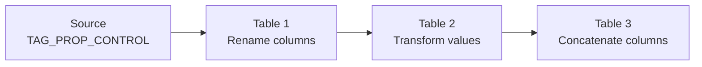

# Test automatic tag propagation through dbt tables

[Documentation](../index.md) · [First deployment](first-deployment.md)

Build three permanent tables that rename columns, transform values, and combine two source columns into one. Apply tags only to the source, then check whether Snowflake propagates them through every step. The example includes a constant column that should receive no source-column lineage tags.

## Before you start

Run from the repository root after completing [the first deployment](first-deployment.md), or use an equivalent [existing corporate setup](../how-to/admin-setup.md#use-existing-corporate-resources). You need:

- Snowflake Enterprise Edition or higher and the pinned Snowflake CLI.
- Separate project administrator and operator connections, an unused native project name, and an isolated model schema.
- An approved tag administrator able to create the source table and tags in that schema. Enabling propagation requires ownership of the tags and account-level `APPLY TAG`.
- An approved verification role able to inspect the tags and select rows from the source and all three outputs. Arrange operator `SELECT` on the source after setup, before the build.

Use existing approved privileges. Follow your administrator's access process if anything is missing; the example does not provision or broaden access. See Snowflake's [propagation requirements](https://docs.snowflake.com/en/user-guide/object-tagging/propagation).

## Understand the chain

This diagram illustrates the example you will build:



| Model table | Changes |
| --- | --- |
| `TAG_PROP_01_RENAMED` | Renames `ID` and `LOADED_AT` to `RENAMED_ID` and `RENAMED_LOADED_AT`. |
| `TAG_PROP_02_TRANSFORMED` | Adds 1000 to the ID, creates uppercase `ID_TEXT`, shifts the timestamp by one hour, and extracts its date. |
| `TAG_PROP_03_CONCATENATED` | Combines `ID_TEXT` and the shifted timestamp into `RECORD_LABEL`; also adds the literal `CONSTANT_MARKER`. |

The dbt project sets `materialized: table` and `transient: false`. Its models contain no tag assignments or tagging hooks.

All four source tags use `PROPAGATE = ON_DEPENDENCY_AND_DATA_MOVEMENT`. Dependency propagation follows objects such as views and updates when source tags change. Data movement propagation applies during operations such as `CREATE TABLE AS SELECT`; it does not continuously synchronize later source-tag changes. This table exercise tests data movement. See [Snowflake's propagation modes](https://docs.snowflake.com/en/user-guide/object-tagging/propagation#types-of-propagation).

## Prepare a local configuration

Copy the example without replacing an existing local file:

```sh
test ! -e deployment/tag-propagation.local.json && \
  cp examples/tag-propagation/deployment.example.json deployment/tag-propagation.local.json
```

Edit the copied JSON:

- Set `source` to `../examples/tag-propagation/project`. Source paths are relative to the configuration file.
- Replace the account, warehouse, native project database/schema, and model database/schema placeholders with your approved destinations.
- Set `deployment_connection`, `deployment_role`, and `deployment_user` for the project administrator; set `connection`, `role`, and `operator_user` for the operator.
- Keep `project: TAG_PROPAGATION_EXAMPLE`, `profile: tag_propagation_example`, and `auto_compile: false`. Choose another unused project name if needed.

The source and output tables use the configured model database and schema. Keep the source variables at their defaults for this exercise. The SQL examples below use `MY_MODEL_DATABASE`, `MY_MODEL_SCHEMA`, and `MY_WAREHOUSE`; replace them with the same settings. Replace the example connection and role names with your approved ones.

```sh
uv run python scripts/dbt_native.py deploy --config deployment/tag-propagation.local.json
```

Check the account, both identities, native project, model destination, and source path. This preview makes no Snowflake connection.

## Create and tag the source

Inspect `examples/tag-propagation/sql/setup.sql`, then run it with the approved tag administrator connection:

```sh
snow sql --connection tag_admin --role TAG_ADMIN --secondary-roles NONE \
  --database MY_MODEL_DATABASE --schema MY_MODEL_SCHEMA --warehouse MY_WAREHOUSE \
  --filename examples/tag-propagation/sql/setup.sql
```

The script creates `TAG_PROP_CONTROL` with three fixed rows and assigns these tags only to the source:

| Tag | Source assignment | Value |
| --- | --- | --- |
| `TAG_PROP_SOURCE` | Table | `tag_prop_control` |
| `TAG_PROP_PURPOSE` | Table | `tag_propagation_example` |
| `TAG_PROP_ID_LINEAGE` | `ID` column | `control_id` |
| `TAG_PROP_TIME_LINEAGE` | `LOADED_AT` column | `loaded_at` |

Have the administrator complete the operator's source access, then confirm the operator can read all three rows:

```sh
snow sql --connection dbt_operator --role DBT_OPERATOR --secondary-roles NONE \
  --database MY_MODEL_DATABASE --schema MY_MODEL_SCHEMA --warehouse MY_WAREHOUSE \
  --query 'SELECT ID, LOADED_AT FROM TAG_PROP_CONTROL ORDER BY ID'
```

## Deploy and build the three tables

The project administrator deploys source and hands off project access:

```sh
uv run python scripts/dbt_native.py deploy --config deployment/tag-propagation.local.json --apply
uv run python scripts/dbt_native.py project-access --config deployment/tag-propagation.local.json
uv run python scripts/dbt_native.py project-access --config deployment/tag-propagation.local.json --apply
```

Expect `Verified deployment:` and `Verified project access:`. For a managed-access object schema, use the [administrator grant path](../how-to/admin-setup.md#complete-project-and-viewer-access-after-deployment) instead of the project-owner access command.

The operator previews and executes the build through its own configured connection:

```sh
uv run python scripts/dbt_native.py run --config deployment/tag-propagation.local.json --command build
uv run python scripts/dbt_native.py run --config deployment/tag-propagation.local.json --command build --apply
```

Expect three successful table models, passing dbt tests, and `dbt build completed successfully.` A successful build establishes that the data transformations worked; the next step checks tags separately.

## Verify automatic propagation

Run the verifier with a role that has the metadata and data access described above. This command uses the tag administrator connection for that readback:

```sh
snow sql --connection tag_admin --role TAG_ADMIN --secondary-roles NONE \
  --database MY_MODEL_DATABASE --schema MY_MODEL_SCHEMA --warehouse MY_WAREHOUSE \
  --filename examples/tag-propagation/sql/verify.sql
```

Every `PASSED` result should be `TRUE`, followed by `PASS: 43 checks`. The verifier checks the source setup, three permanent output tables, row counts, and 28 downstream tag expectations. Positive tag checks require the correct tag database, schema, name, value, and `APPLY_METHOD = 'PROPAGATED'`. Negative checks confirm that a lineage tag did not spread to an unrelated column. The final assertion fails if any check fails or the check count changes.

Inspect these results in particular:

| Target | Expected tags |
| --- | --- |
| Each of the three output tables | Both table tags, reported as `PROPAGATED`. |
| `TAG_PROP_03_CONCATENATED.RECORD_LABEL` | Both ID and timestamp lineage tags, reported as `PROPAGATED`. |
| `TAG_PROP_03_CONCATENATED.FINAL_ID` | The ID lineage tag; no timestamp lineage tag. |
| `TAG_PROP_03_CONCATENATED.CONSTANT_MARKER` | Neither lineage tag. |

`PROPAGATED` records automatic assignment from a source. `MANUAL` records an explicit assignment, as on this fixture's source. `INHERITED` records a tag received through Snowflake's object hierarchy, such as a column inheriting its table's tag. The constant can therefore inherit the two table tags while still having no source-column lineage tags. A visible tag value alone does not establish automatic propagation. See the [column tag metadata reference](https://docs.snowflake.com/en/sql-reference/functions/tag_references_all_columns).

If verification fails, check the selected model destination, source setup, tag visibility, and the failing row's expected and actual values. Investigate before changing any downstream tag manually.

## Inspect the tags in Snowsight

Open **Catalog → Explorer**, choose `TAG_PROP_CONTROL`, and open **Lineage**. With an approved viewer role:

1. Select a table node to open its side panel. If selection only highlights the graph, open the node's **⋮ → More info** menu. Table tags appear under **Details**.
2. Under **Columns**, hover over a tag icon to read its name and value.
3. Hover over source column `ID`, choose its **View Lineage** icon, then **Downstream Lineage**. The dialog's **Tags** column lets you compare tags through all three tables. A dashed border indicates a missing tag; yellow indicates a value mismatch. Expand a **+1** badge to inspect an additional tag, such as the second lineage tag on `RECORD_LABEL`.

**Review and Apply** changes assignments manually. Use the SQL verifier to establish automatic propagation before considering that action. These tag details complement the table and column graph; see [working with tags in lineage](https://docs.snowflake.com/en/user-guide/ui-snowsight-lineage#work-with-tags).

For a tag-centered list, open **Governance & security → Tags & policies → Tagged Objects**. Choose tables or columns and filter by one of the four tags. This area needs an approved governance viewer role and a running warehouse. Tagged Objects can lag by up to two hours; the Dashboard refreshes every 12 hours. Use the SQL verification results when checking a new build. See [monitoring object tags](https://docs.snowflake.com/en/user-guide/object-tagging/monitor).

## Repeat or remove the example

Run setup once in a fresh schema, then repeat the dbt build and verification as needed. A new build replaces the three model tables. Source-tag edits alone do not update tags already copied through data movement.

When finished, have the appropriate owners remove only this example's native project, three output tables, `TAG_PROP_CONTROL`, and four `TAG_PROP_*` tags. Keep shared databases, schemas, roles, users, and warehouses.
